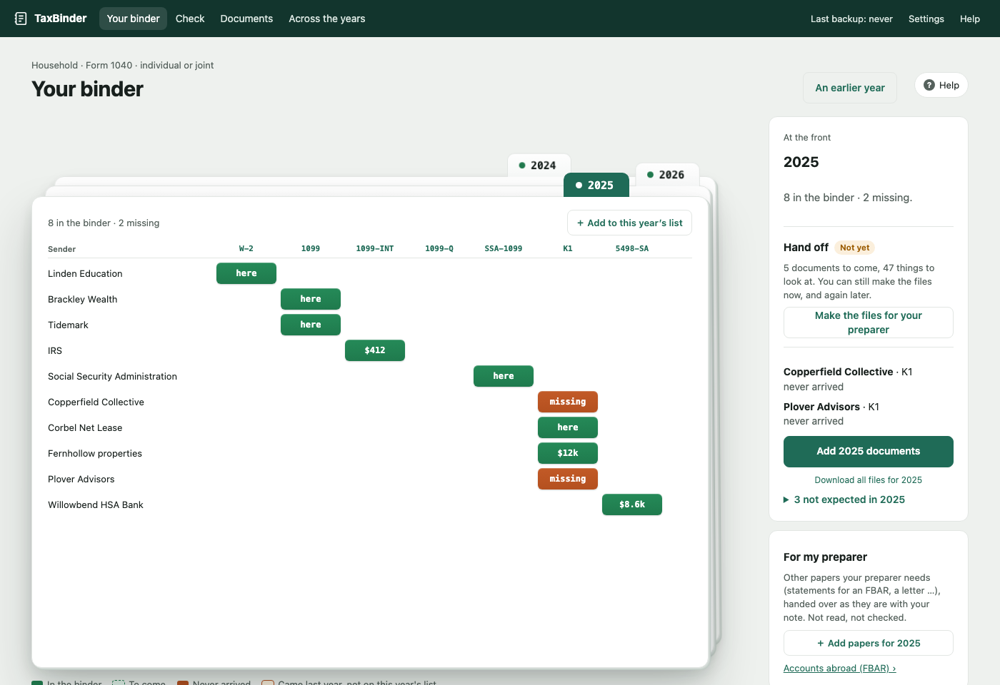

# TaxBinder

A desktop app that keeps a household's tax documents in order. It knows which documents to
expect each year, reads them as they arrive, checks them against each other, and puts together
the files your tax preparer needs. Everything stays on your computer.



> **Not tax advice.** TaxBinder organises and checks documents. It doesn't prepare or file
> returns or tell you what to file, and its checks (deadlines, thresholds, missing letters) can
> be wrong or out of date. Confirm anything that matters with a tax professional.

## What it does

- **Your binder, a deck of years.** Each tax year is a card: senders down, kinds of document
  across, each square in the binder, still to come, missing, or not expected this year.
- **Add documents.** Drop PDFs, scans or photos (or a whole folder), or put them in an inbox
  folder. Each one is read on your computer: what it is, who sent it, whose it is, its tax year
  and its key amounts. Anything TaxBinder isn't sure of is asked, never guessed.
- **Read twice.** Every form is read by rules (its layout and its own arithmetic) and, on a
  computer with 16 GB of memory, again by an AI model that runs on that computer. Boxes the two
  agree on are filled in; the others are shown for you to confirm.
- **Check.** A rule book of deterministic checks: documents still missing near the deadline,
  estimated-tax payments against the IRS's and each state's dates, the letters and records each
  donation needs, foreign accounts over the FBAR line, a sender that came last year but isn't
  expected this year, a corrected form your preparer hasn't seen, amounts that disagree.
- **Across the years.** The key amount of every document, one row per document and a column
  per year, editable, with big changes from the year before marked. Exports to Excel.
- **Payments, donations, accounts abroad, and papers for your preparer**, each with the
  documents they need.
- **Files for your preparer.** One .zip per year: documents by type, payments and donations,
  what's still to come, and a summary. TaxBinder never sends it anywhere.
- **Text for an AI chat.** Selected documents as text with names and numbers replaced by
  placeholders, for you to paste into a chat yourself, and the answer translated back.
- **Undo.** Every change is recorded and can be undone.
- **Backups.** Every binder as one encrypted file, opened by your computer's key or your
  recovery key.
- **Shared at home** (optional). A second device on your home network, paired with a one-time
  code, over HTTPS.

## Privacy

- No account, no cloud service, no usage tracking, no crash reporting, no AI service on the
  internet.
- Documents are encrypted with [age](https://age-encryption.org), and so are account numbers,
  SSNs and EINs inside the records. The key is in the macOS Keychain; a recovery key is yours to
  keep.
- Anything shown in the app or a finding masks account numbers as `…1234`.
- The app's pages are served to its own window over 127.0.0.1 only, with a one-time session code
  and a strict content security policy.

What is and isn't encrypted, and everything that ever goes over the network, is listed in
[the guide](docs/guide.md#privacy) and in the app's Help.

## Status

Runs on **macOS 13 or later on Apple Silicon**. Windows and Intel Macs aren't supported. There
are no signed downloads yet: build it from source (below).

Estimated-payment dates cover the IRS and every state and DC. Each state's dates are marked
"not reviewed" in the app until a person has checked them against that state's own pages.

## Build and run

You need macOS on Apple Silicon, [uv](https://docs.astral.sh/uv/), Node.js, Rust and the Xcode
command line tools.

```bash
make setup     # Python environment, the Tauri CLI and the reading engine
make test      # ruff, pytest and the shell's Rust tests
make install   # build TaxBinder.app into /Applications (quit TaxBinder first)
```

Open TaxBinder like any other app. The first time, macOS asks whether `taxbinder-backend` may
use the "com.4ampersand.taxbinder" Keychain item: choose **Always Allow**.

To look around without your own documents, choose **Try with sample data** on the first screen:
an invented family's binder, kept apart from yours.

To work on the code, use a throwaway vault, never your real one:

```bash
export TAXBINDER_VAULT=~/.taxbinder-dev/vault
uv run taxbinder init
uv run python -m tests.quills   # the invented household's 2025
make dev                        # the app, from the source tree, on $TAXBINDER_VAULT
```

## Documentation

- [Product](docs/product.md): who it's for, the ideas it's built on, what it does and doesn't do.
- [Guide](docs/guide.md): using the app, from the first run to backups and a new Mac.
- [Command line](docs/cli.md): every `taxbinder` command.
- [Architecture](docs/architecture.md): the records, the vault, reading, the rules, security.
- [Contributing](CONTRIBUTING.md), [Releasing](RELEASING.md), [Security](SECURITY.md).

## Contributing

Issues and pull requests are welcome: see [CONTRIBUTING.md](CONTRIBUTING.md). Your first pull
request asks you to sign the [Contributor License Agreement](CLA.md) with a one-line comment.
Never include real tax data, account numbers or names; use invented ones. Report security
problems privately, as [SECURITY.md](SECURITY.md) says.

## Licence

Copyright 2026 Shahid Ahmed. Licensed under the
[GNU Affero General Public License, version 3 or later](LICENSE).

You may use, study, change and share TaxBinder, commercially too. If you distribute a changed
version, or let people use one over a network, you must make its complete source available to
them under the same licence.
